<p align="center">
  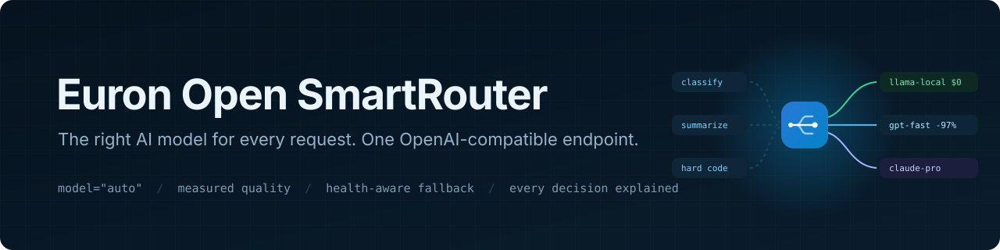
</p>

<p align="center">
  
  <a href="LICENSE"></a>
  
  
  
  
  
  
  
</p>

<p align="center">
  <a href="https://github.com/euron-sde-team/euron-open-smart-router/stargazers"></a>
  <a href="https://github.com/euron-sde-team/euron-open-smart-router/fork"></a>
  <a href="https://github.com/euron-sde-team/euron-open-smart-router/watchers"></a>
  <br>
  <a href="https://github.com/euron-sde-team/euron-open-smart-router/issues"></a>
  <a href="https://github.com/euron-sde-team/euron-open-smart-router/pulls"></a>
  <a href="https://github.com/euron-sde-team/euron-open-smart-router/commits/main"></a>
  
  <br>
  <a href="#built-by-the-team-behind-euron"></a>
</p>

<p align="center">
  <b><a href="#-quickstart">Quickstart</a></b> ·
  <b><a href="#️-architecture">Architecture</a></b> ·
  <b><a href="#-benchmark-results">Benchmark</a></b> ·
  <b><a href="docs/guides/integrate.md">Integrate</a></b> ·
  <b><a href="docs/api/openapi.yaml">API reference</a></b> ·
  <b><a href="#️-deploy-to-aws">Deploy</a></b> ·
  <b><a href="docs/architecture/security.md">Security</a></b> ·
  <b><a href="#-documentation">Docs</a></b>
</p>

**Euron Open SmartRouter** is an open-source, MIT-licensed, self-hosted model router, part of
the open-source initiative of **ENGAGESPHERE TECHNOLOGY PRIVATE LIMITED**. It sits between
your applications and every model you can call, and sends each request to the cheapest model
that is good enough for it. Every decision is logged with its reasons.

Point any OpenAI SDK at it and send `model="auto"`. Behind that one endpoint:

- **Routing on measured quality.** Each request is analysed (task, difficulty, needs), and
  the eligible models are ranked by cost, latency and quality measured on a graded
  benchmark. The router allows for the analyzer misjudging difficulty instead of
  pretending it never does.
- **Policies, not guesswork.** Cost first, latency first, quality first or balanced, each
  with a quality floor, per-task floors, ceilings and allowed models. A concrete model name
  is passed through, never silently switched.
- **Fallback that respects health.** Circuit breakers shared by every replica skip failing
  models, and retryable errors fall back to the next eligible model. Every hop is recorded.
- **Every decision explained.** Candidates, scores, reasons, cost and the saving against
  always using the best model, for every request, in the dashboard and the response headers.
- **Works with TokenShield.** Route through a TokenShield gateway and its budget ledger stays
  the single source of spend: SmartRouter reads the actual cost back and honours budget
  refusals.

The whole stack runs on a laptop against an AWS emulator, and deploys to AWS from the same
Terraform.

<p align="center">
  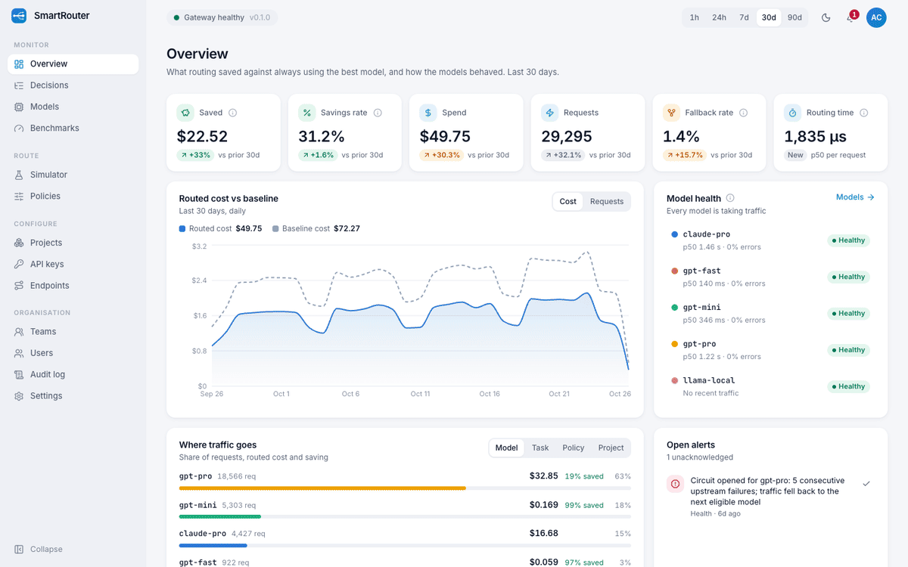
</p>

> [!NOTE]
> Everything in the tour ran for real: Docker Compose on a laptop, with KMS and S3 emulated
> locally and provisioned by the same Terraform modules that build production. The demo
> seed runs the real benchmark and backfills 60 days of routing history; the most recent
> decisions, including a simulated provider outage with fallbacks and a TokenShield budget
> refusal, are live traffic through the gateway to a mock provider. `make up && make demo`
> reproduces it.

<h3 align="center">Built by the team behind Euron</h3>

<p align="center">Euron Open SmartRouter comes from the people who build these platforms. If you like how this repository is built, come and see what we build with it.</p>

<p align="center">
  <a href="https://euron.one"><picture><source media="(prefers-color-scheme: dark)" srcset="docs/assets/brand/euron-dark.svg"></picture></a>
  <a href="https://euronsystems.com"><picture><source media="(prefers-color-scheme: dark)" srcset="docs/assets/brand/euron-systems-dark.svg"></picture></a>
  <a href="https://alphaeuron.com"><picture><source media="(prefers-color-scheme: dark)" srcset="docs/assets/brand/alpha-euron-dark.svg"></picture></a>
</p>

<p align="center">
  <a href="https://www.instagram.com/euron_official"></a>
  <a href="https://www.linkedin.com/company/euronone/posts/"></a>
  <a href="https://x.com/euron712"></a>
  <a href="https://www.youtube.com/@Euron-official"></a>
  <a href="https://whatsapp.com/channel/0029VaeeJwq9RZAfPW9P2l07"></a>
</p>

---

## 📚 Table of contents

- [Why SmartRouter](#-why-smartrouter)
- [At a glance](#-at-a-glance)
- [Benchmark results](#-benchmark-results)
- [Screenshots](#️-screenshots)
- [Features](#-features)
- [Architecture](#️-architecture)
  - [Life of a request](#life-of-a-request)
- [Performance](#-performance)
- [Tech stack](#-tech-stack)
- [Prerequisites](#-prerequisites)
- [Quickstart](#-quickstart)
- [Explore the repository](#-explore-the-repository)
- [Integrate](#-integrate)
- [Configuration](#️-configuration)
- [Deploy to AWS](#️-deploy-to-aws)
- [Security model](#-security-model)
- [Testing](#-testing)
- [Documentation](#-documentation)
- [Roadmap](#️-roadmap)
- [FAQ](#-faq)
- [Contributing, security and license](#-contributing-security-and-license)

## 💡 Why SmartRouter

Most teams pick one strong model and send it everything. Classifying a support ticket,
pulling an email address out of a sentence and reviewing a concurrency bug all go to the
same model, at the same price. The simple requests are the majority, and they are paid at
top-model rates.

Routing them to cheaper models sounds easy and goes wrong quietly. A router that guesses
"easy" from keywords sends hard work to a weak model, quality drops, nobody notices until
users complain, and the savings figure on the dashboard was computed on the very examples
the router was tuned on. SmartRouter is built to be checked:

- quality comes from a **graded benchmark you can run on your own endpoints**, not from a
  model's marketing tier;
- savings are measured **out of sample**: each case is routed with scores learned from
  the other half of the suite;
- the analyzer's **own error rate is measured** and priced into every ranking;
- every decision carries its **candidates, scores and reasons**, so a bad choice can be seen
  and challenged.

And it stays out of the way: no SDK changes, about 4.0 ms of overhead per
routed request, and a concrete model name always goes exactly where it says.

## 📊 At a glance

| | |
| --- | --- |
| **Surface** | OpenAI-compatible `/v1/chat/completions` (streaming), `/v1/models`, `/v1/feedback` |
| **Endpoints** | Any OpenAI-compatible API (OpenAI, Groq, vLLM, Ollama, LM Studio), the native Anthropic Messages API, and TokenShield gateways |
| **Routing** | `model="auto"` or `auto:<policy>`; cost, latency, quality or balanced strategies; quality floors per task and difficulty |
| **Quality** | 160 graded cases across 8 tasks and 5 difficulty levels, run on every model and every policy, cross-fitted |
| **Result** | The balanced policy kept quality within 1.9 points of always using the best model and cut cost by 19.8% ([details](#-benchmark-results)) |
| **Reliability** | Per-model circuit breakers shared across replicas, health probes, ordered fallback on retryable errors |
| **Overhead** | 4.0 ms p50 per routed request, 2.3 ms for a pinned model ([how measured](#-performance)) |
| **Infrastructure** | 9 Terraform modules, 3 environments (local emulator, AWS dev, AWS prod); the full AWS stack applied end to end against Floci |
| **Tests** | 187 unit, 77 integration (run under 4 backend combinations), 12 browser end-to-end, a browser QA sweep |
| **License** | MIT |

## 📈 Benchmark results

`make benchmark` sends 160 graded cases to every model, then routes the same cases through
every policy. Policies are **cross-fitted**: each case is routed with quality scores, and
with a measure of how often the analyzer misjudges difficulty, learned only from the other
half of the suite. Results from the demo catalog, where claude-pro is the baseline every
saving is measured against:

| Target | Quality | Change vs baseline | Cost of the suite | Saved |
| --- | --- | --- | --- | --- |
| claude-pro (always) | 88.1% | | $0.0646 | |
| **auto:quality** | **89.4%** | **+1.3 points** | $0.0609 | **5.7%** |
| **auto:balanced** | **86.3%** | **-1.9 points** | $0.0518 | **19.8%** |
| auto:cost | 78.8% | -9.4 points | $0.0406 | 37.2% |
| gpt-pro (always) | 84.4% | -3.7 points | $0.0557 | 13.8% |

The quality floor is the dial: the balanced policy at a 0.70 floor saved 37.2% for a
9.4-point loss, and at 0.80 it saved 19.8% for 1.9 points. Quality-first routing beat the
baseline on quality and still cost less, because it sends work to the model that is best at
each task rather than the one that is best on average.

Two honest caveats. The demo's models are **simulated** with per-task skills, so these
numbers show the method works, not what your providers will score: run the benchmark against
your own endpoints, which the dashboard and `make benchmark` both do. And a router graded on
the cases it was tuned on looks far better than it is; ours did, until we cross-fitted. The
full story is in [the benchmark design](docs/architecture/benchmarks.md). Every graded answer
of every run downloads as a file, so you can audit the grading yourself.

## 🖼️ Screenshots

<table>
  <tr>
    <td width="50%">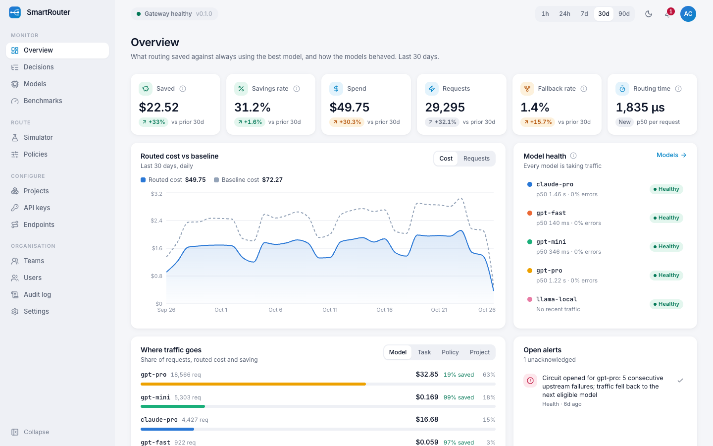<br><sub><b>Overview.</b> What routing saved against always using the best model, routed cost against the baseline over time, live model health and where traffic goes.</sub></td>
    <td width="50%">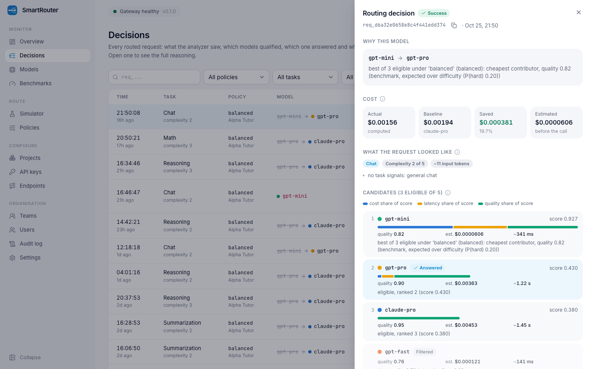<br><sub><b>Why this model.</b> The analyzer's signals, every candidate's score split by cost, latency and quality, the fallback chain, and the cost against the baseline.</sub></td>
  </tr>
  <tr>
    <td>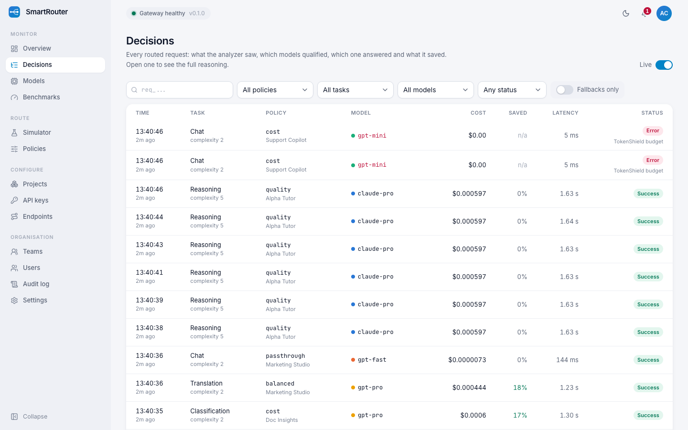<br><sub><b>Decision log.</b> Every routed request, live, filterable by policy, task, model, status and fallbacks.</sub></td>
    <td>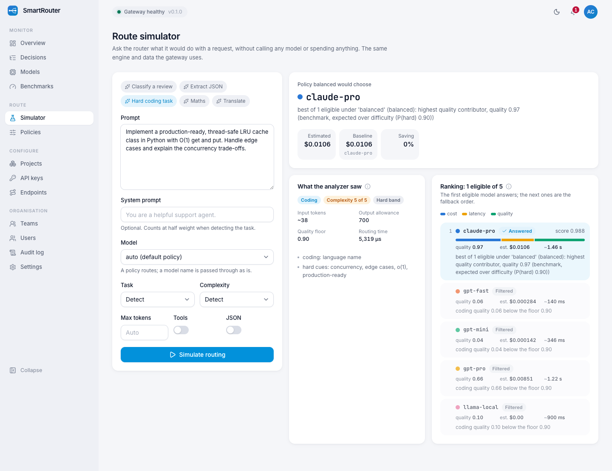<br><sub><b>Route simulator.</b> Ask what the router would do with a prompt, without calling any model.</sub></td>
  </tr>
  <tr>
    <td>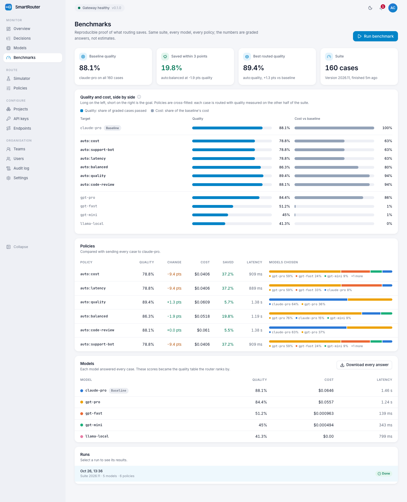<br><sub><b>Benchmarks.</b> Quality and cost of every model and policy side by side, cross-fitted, with every answer downloadable.</sub></td>
    <td>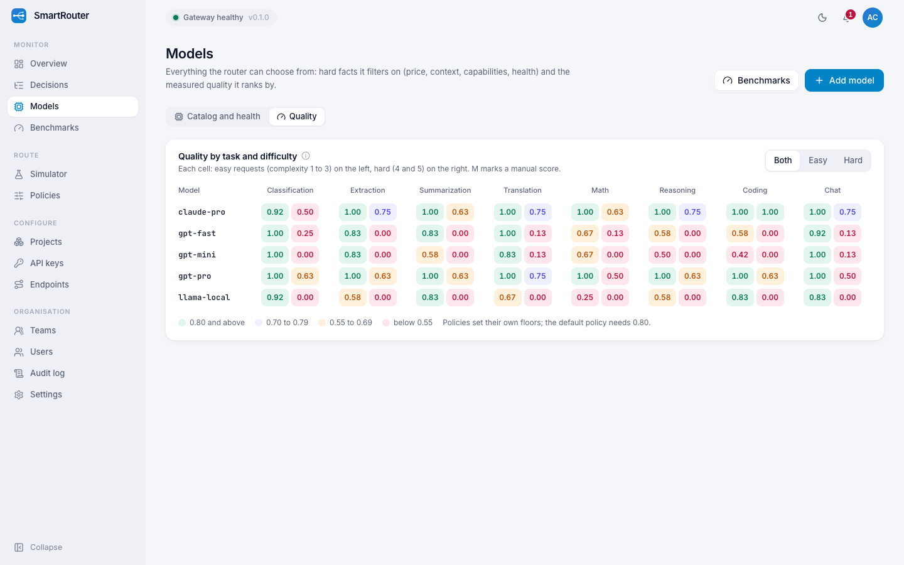<br><sub><b>Quality matrix.</b> Measured quality per model, task and difficulty: the table the router ranks by.</sub></td>
  </tr>
  <tr>
    <td>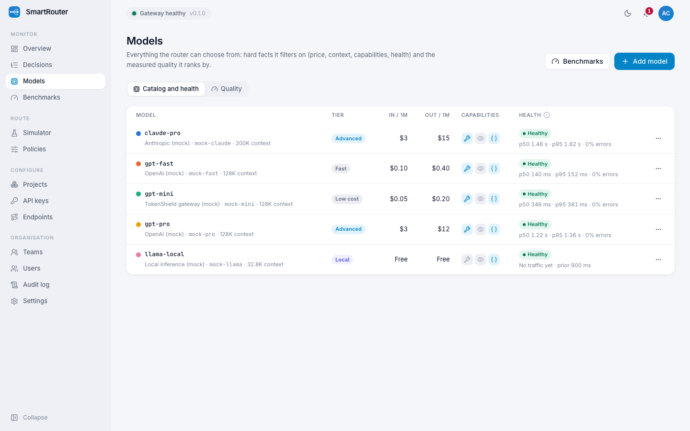<br><sub><b>Models.</b> Prices, tiers, capabilities and live circuit-breaker state with latency percentiles.</sub></td>
    <td>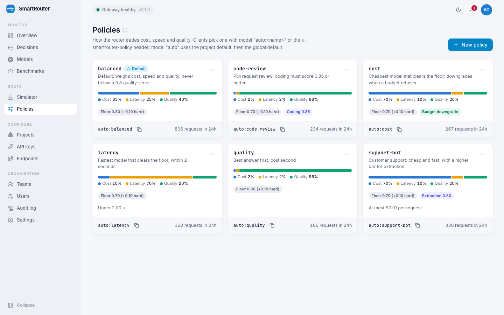<br><sub><b>Policies.</b> Each policy's weights, floors and limits, and how much traffic it routes.</sub></td>
  </tr>
  <tr>
    <td>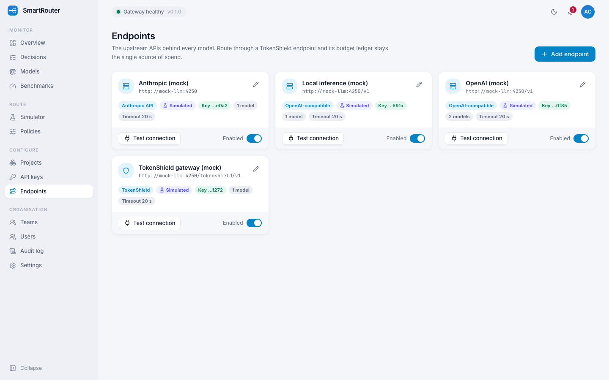<br><sub><b>Endpoints.</b> OpenAI-compatible, Anthropic, local and TokenShield upstreams, with a live connection test.</sub></td>
    <td>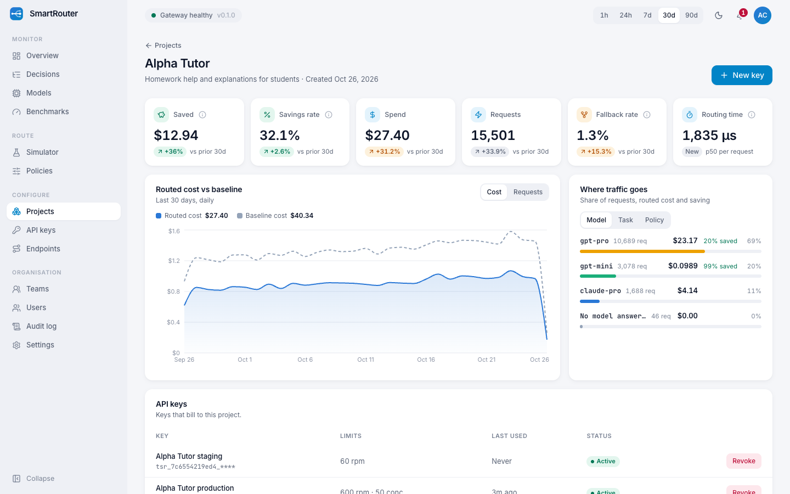<br><sub><b>Project.</b> One workload's savings, traffic, keys and default routing policy.</sub></td>
  </tr>
  <tr>
    <td>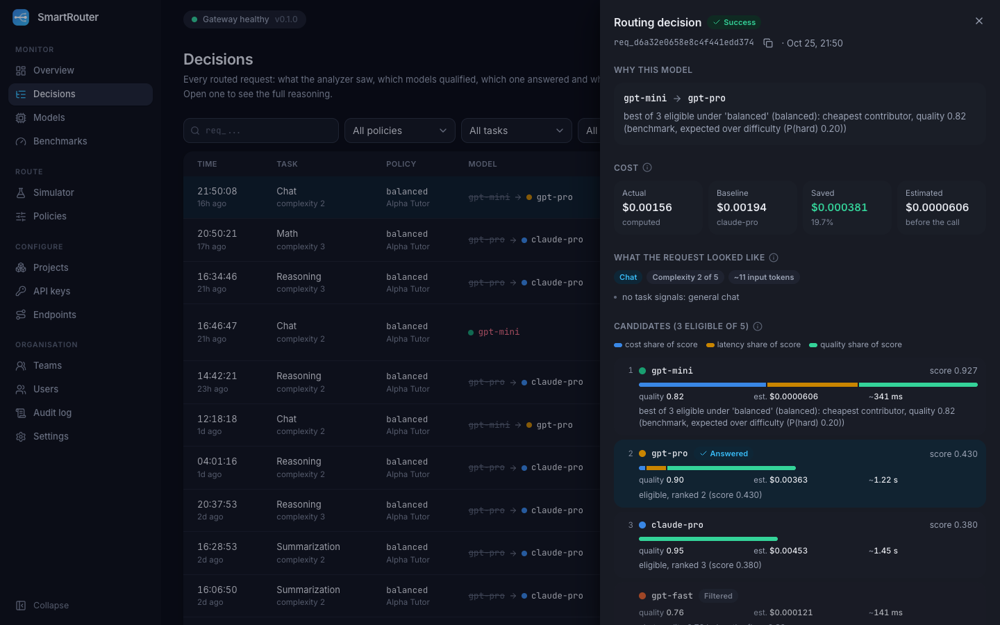<br><sub><b>Dark mode.</b> Every screen, in both themes; here a decision that fell back during an outage.</sub></td>
    <td align="center">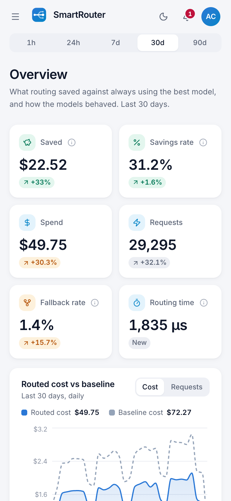<br><sub><b>Phone.</b> Responsive down to phone width.</sub></td>
  </tr>
</table>

## ✨ Features

#### 🧭 Routing
- `model="auto"` uses the project's default policy, then the global default; `auto:<policy>`
  or the `x-smartrouter-policy` header picks one; a concrete model is passed through.
- Deterministic request analysis: 8 tasks, complexity 1 to 5 with the signals behind it,
  required capabilities. Callers can override task and complexity with headers.
- Hard filters first (allowed and excluded models, context window, tools, vision, JSON, open
  circuits, cost and latency ceilings, the quality floor), then a weighted score over cost on
  a log scale, latency and expected quality. Ties break deterministically.
- When nothing clears the floor, the policy either uses the best available models (recorded
  as "floor relaxed") or rejects with `422 no_eligible_model`.

#### 📏 Quality
- A 160-case benchmark suite with deterministic graders, run from the dashboard or `make
  benchmark`, on every model and then through every policy.
- Small benchmark cells are shrunk toward each model's overall score per difficulty band plus
  a per-task offset; manual scores for models a benchmark cannot reach.
- The router ranks by expected quality over both difficulty bands, weighted by the measured
  chance the analyzer got the difficulty wrong.

#### 🛟 Reliability
- Live latency percentiles, error rates and a circuit breaker per model in Redis, shared by
  every replica; the worker probes endpoints and closes recovered circuits.
- Fallback on connection errors, timeouts, 429 and 5xx, in rank order, before the first
  streamed byte only; a TokenShield `402` retries only cheaper models, when the policy allows.
- One alert per model per hour when a circuit opens, and a CloudWatch alarm on AWS.

#### 📈 Visibility
- An append-only decision log written through a Redis Stream, with hourly rollups for the
  dashboard and Prometheus metrics for decisions, fallbacks, savings and routing time.
- Savings against a baseline per request, policy, model, task and project; quality feedback
  through `POST /v1/feedback`.

## 🏗️ Architecture

<p align="center">
  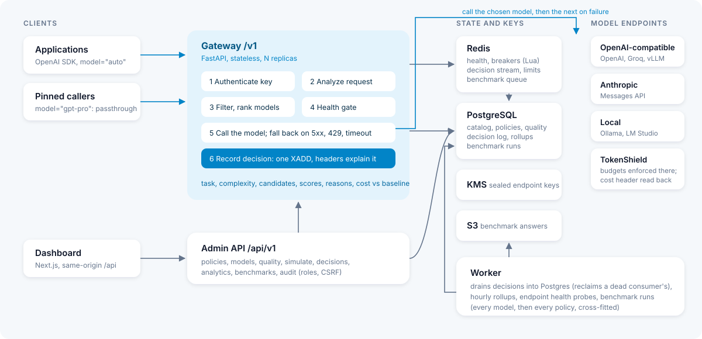
</p>

One Python package serves the gateway (`/v1`) and the dashboard API (`/api/v1`); a worker
process drains decisions and runs background jobs; the Next.js dashboard proxies to the API.
The routing catalog is cached in each process and invalidated cluster-wide through a Redis
version stamp, so the hot path never waits on Postgres.

### Life of a request

1. **Authenticate**: parse `tsr_<prefix>_<secret>`, check the peppered hash, apply the key's
   rate and concurrency limits.
2. **Resolve the policy**: `auto:<policy>`, the header, the project default, the global
   default; or pass a concrete model through.
3. **Analyze**: task, complexity and the signals behind them, input tokens, capabilities.
4. **Rank**: hard filters, then cost, latency and expected quality; one Redis round trip for
   the health of every model.
5. **Call**: the first eligible model whose circuit allows it; on a retryable failure, the
   next one.
6. **Record**: one stream append with the whole decision; the response carries the chosen
   model, policy, task, cost, baseline cost and reason as headers.

The full walkthrough is in the [LLD](docs/architecture/LLD.md) and the routing math in
[routing](docs/architecture/routing.md).

## 🚀 Performance

Measured with `make bench` against the production images in Docker Compose on a laptop
(Apple silicon, Docker Desktop), 400 sequential requests per row to a mock provider that answers
instantly:

| | p50 | p95 |
| --- | --- | --- |
| Provider called directly | 0.7 ms | 1.1 ms |
| Through SmartRouter, pinned model | 3.0 ms | 4.4 ms |
| Through SmartRouter, `model="auto"` | 4.8 ms | 5.6 ms |
| **Overhead, pinned** | **2.3 ms** | **3.6 ms** |
| **Overhead, routed** | **4.0 ms** | **4.8 ms** |

Planning a routed request (analysis, one pipelined Redis call for the health of every
candidate, and ranking) is measured on every decision: a median of 1.6 ms, p95 1.8 ms. What keeps the rest low: no database on the request
path, health for every candidate in one pipelined Redis call, and the decision written with a
single stream append.

## 🧰 Tech stack

| Layer | Technology |
| --- | --- |
| Gateway, API, worker | Python 3.12, FastAPI, Pydantic v2, SQLAlchemy 2 (async, asyncpg), Alembic, redis-py, httpx, tiktoken |
| Dashboard | Next.js 15 (App Router), React 19, TypeScript, Tailwind CSS 4, shadcn components, TanStack Query, Recharts |
| Data | PostgreSQL 16, Redis 7 (Valkey on AWS), S3 for benchmark result files |
| AWS | ECS Fargate, ALB, WAF, RDS, ElastiCache, S3, KMS, Secrets Manager, ECR, CloudWatch |
| Local | Docker Compose, Floci (AWS emulator), a deterministic mock LLM with per-task skill |
| Quality | pytest, Vitest, Playwright, Puppeteer, ruff, mypy `--strict`, ESLint, tflint, checkov, gitleaks |

## 📋 Prerequisites

- Docker with Compose v2
- `make`, `bash`, `openssl`
- For development outside containers: Python 3.12 with [uv](https://docs.astral.sh/uv/),
  Node 22 and pnpm 9

## 🚀 Quickstart

```bash
git clone https://github.com/euron-sde-team/euron-open-smart-router.git
cd euron-open-smart-router
make up      # Postgres, Redis, Floci (provisioned by Terraform), mock LLM, api, worker, dashboard
make demo    # runs the benchmark, 60 days of history, live traffic; prints the login and a key
```

Open the dashboard at http://localhost:4210 and sign in with the printed credentials. Then
call the gateway like any OpenAI endpoint:

```python
from openai import OpenAI

client = OpenAI(base_url="http://localhost:4230/v1", api_key="tsr_...")  # the key make demo printed
raw = client.chat.completions.with_raw_response.create(
    model="auto",
    messages=[{"role": "user", "content": "Classify the sentiment: I love this product"}],
)
print(raw.headers["x-smartrouter-model"], raw.headers["x-smartrouter-reason"])
print(raw.parse().choices[0].message.content)
```

Try a hard coding task next and watch it go to a stronger model; open the decision in the
dashboard to see why. [examples/](examples/) has the same flow in Python and Node.
[The quickstart guide](docs/guides/quickstart-local.md) also walks
through an outage with fallback and a TokenShield budget refusal. `make down` removes
everything.

## 🧭 Explore the repository

```text
euron-open-smart-router/
├── apps/
│   ├── api/                 Python package: gateway, admin API, worker, mock LLM
│   │   └── src/smartrouter/
│   │       ├── gateway/         the request pipeline, auth, catalog and quality model, streaming
│   │       ├── routing/         request analyzer, ranking engine, policies, simulator
│   │       ├── health/          per-model health windows and circuit breakers (Redis Lua)
│   │       ├── benchmarks/      the graded suite, the cross-fitted runner, result files
│   │       ├── decisions/       decision stream recorder, log, analytics, rollups
│   │       ├── providers/       endpoint catalog and adapters (OpenAI-compatible, Anthropic, TokenShield)
│   │       ├── limits/          sliding-window rate and concurrency limits
│   │       ├── projects/ teams/ keys/ users/ auth/ alerts/ audit/ system/ pricing/
│   │       ├── core/            config and boot guards, db, redis, errors, sealing, storage, tracing
│   │       ├── migrations/      Alembic revisions
│   │       └── worker.py        background jobs
│   └── web/                 Next.js dashboard (features/<domain>, components, lib)
├── infra/
│   ├── terraform/           modules + envs (local-floci, aws-dev, aws-prod)
│   └── docker/              api and web images
├── deploy/compose/          the local stack (Floci or real AWS overlay)
├── e2e/                     Playwright browser tests
├── examples/                runnable Python and Node clients (model="auto", headers, feedback)
├── scripts/                 AWS deploy, QA sweep and screenshots, test matrix, sanitization check
└── docs/                    architecture, ADRs, guides, OpenAPI
```

## 🔌 Integrate

Any OpenAI-compatible client works. Optional headers steer the router:

| Header | Effect |
| --- | --- |
| `x-smartrouter-policy` | The policy for `model="auto"` |
| `x-smartrouter-task` | Override the detected task |
| `x-smartrouter-complexity` | Override the detected complexity (1 to 5); trusted as given |

Every response carries `x-smartrouter-request-id`, the chosen `-model`, `-policy`, `-task`
and `-complexity`, the estimated, actual and baseline cost, any `-fallbacks`, and a short
`-reason`. Errors use the OpenAI envelope with a stable `code` (`policy_not_found`,
`no_eligible_model`, `all_models_failed`, `rpm_limit` and more). See the
[integration guide](docs/guides/integrate.md) and the [OpenAPI reference](docs/api/openapi.yaml)
(interactive at `/docs`).

## ⚙️ Configuration

All settings are environment variables, validated at boot; production refuses to start with
development secrets. The most important:

| Variable | Default | |
| --- | --- | --- |
| `BREAKER_FAILURE_THRESHOLD` | `5` | Consecutive failures that open a model's circuit |
| `BREAKER_COOLDOWN_S` | `30` | Seconds before an open circuit lets one probe through |
| `UPSTREAM_TIMEOUT_S` | `60` | Default upstream timeout when an endpoint sets none |
| `KEY_MODE` | `local` | `kms` seals endpoint credentials with AWS KMS |
| `STORAGE` | `local` | `s3` for benchmark result files |
| `HEALTH_PROBE_INTERVAL_S` | `15` | How often the worker probes each endpoint |

Policies, models and endpoints are configured in the dashboard or the admin API. The full
list is in the [configuration reference](docs/guides/configuration.md).

## ☁️ Deploy to AWS

```bash
cp infra/terraform/envs/aws-dev/terraform.tfvars.example infra/terraform/envs/aws-dev/terraform.tfvars
make aws-deploy ENV=aws-dev            # registries, arm64 images, infrastructure, migrations, rollout
make aws-admin ENV=aws-dev EMAIL=you@example.com   # the first owner, with a one-time password
```

This creates a VPC, RDS PostgreSQL, ElastiCache (TLS, auth, `noeviction`), an encrypted
bucket for benchmark results, a KMS key, Secrets Manager entries, ECR, ECS Fargate services
behind an ALB with WAF, and CloudWatch alarms including one on circuit openings. The
maintainers develop against the local emulator; the AWS environments pass `terraform
validate`, tflint and checkov, and the full `aws-dev` stack is applied and destroyed against
Floci (`make tf-aws-on-floci`). Step by step: [deploy guide](docs/guides/deploy-aws.md).

## 🔐 Security model

| Area | How |
| --- | --- |
| Gateway keys | `tsr_<prefix>_<secret>`, stored as a peppered hash, shown once, per-key rate and concurrency limits, expiry and revocation |
| Endpoint credentials | Write-only, sealed with KMS (or AES-GCM locally) using a per-record encryption context, never returned or logged; moving an endpoint to another host requires its key again |
| Endpoint URLs | Cloud metadata and link-local addresses refused, private networks only when allowed (`ENDPOINT_ALLOW_PRIVATE`), checked against every address a host resolves to |
| Routing | Policy filters (allowed models, capabilities, context) are hard; pinned models are never switched; the benchmark answer key reaches simulated endpoints only |
| Dashboard | argon2id, lockout and throttling, owner/admin/viewer roles enforced in the API, CSRF header, sessions die on password or role change; client addresses trusted only from configured proxies |
| Data | Prompts are not stored: decisions keep the analyzer's signals, not the text; append-only decision, feedback and audit tables |
| Infrastructure | Private subnets, TLS everywhere, KMS encryption, least-privilege task roles, WAF, `/metrics` restricted, checkov clean |

Report vulnerabilities privately: see [SECURITY.md](SECURITY.md). Details:
[security](docs/architecture/security.md), [threat model](docs/architecture/threat-model.md).

## 🧪 Testing

| Suite | What it proves | Run |
| --- | --- | --- |
| Unit (187) | Request analysis, the ranking engine, the quality model and calibration, graders and the suite, the mock models, provider translation, security primitives, config guards, dashboard logic and components | `make test` |
| Integration (77) | Every acceptance criterion against Postgres, Redis and a mock provider over HTTP: an unmodified OpenAI SDK, strategies, hard constraints, the quality floor, fallback and circuit breakers, passthrough, the decision log, TokenShield cost and 402 downgrade, the reproducible benchmark and its result files, RBAC | `make test-integration` |
| Option matrix (4 runs) | The integration suite under every key and storage backend (local or KMS, disk or S3) on Floci | `make test-matrix` |
| Browser (12) | Create a project with a policy and a key in the dashboard, call the gateway with `model="auto"`, read the decision; policies, the simulator, models, benchmarks and roles | `make e2e` |
| Browser QA | Every page in light and dark at desktop and phone width: no console errors, failed requests, broken images or overflow | `make qa` |
| Infrastructure | `terraform validate` (3 environments), tflint, checkov, sanitization (secrets, account ids, em and en dashes) | `make tf-validate tf-lint tf-security sanitize` |
| AWS on Floci | The full production environment (149 resources: VPC, RDS, ElastiCache, ECS Fargate, ALB, WAF, KMS, S3, Secrets Manager, ECR, CloudWatch) plans, applies, converges and destroys against an AWS API | `make tf-aws-on-floci` |
| Routing benchmark | 160 graded cases on every model and policy, cross-fitted; savings against quality | `make benchmark` |

[Testing guide](docs/guides/testing.md)

## 📖 Documentation

| Architecture | Guides |
| --- | --- |
| [High-level design](docs/architecture/HLD.md) | [Quickstart (local)](docs/guides/quickstart-local.md) |
| [Low-level design](docs/architecture/LLD.md) | [Integrate an application](docs/guides/integrate.md) |
| [Routing](docs/architecture/routing.md) | [Configuration reference](docs/guides/configuration.md) |
| [Health and fallback](docs/architecture/health-and-fallback.md) | [Deploy to AWS](docs/guides/deploy-aws.md) |
| [Benchmarks](docs/architecture/benchmarks.md) | [Local against real AWS](docs/guides/local-with-aws.md) |
| [Caching](docs/architecture/caching.md) | [Operations runbook](docs/guides/operations.md) |
| [Data model](docs/architecture/data-model.md) | [Testing](docs/guides/testing.md) |
| [Security](docs/architecture/security.md) | [Troubleshooting](docs/guides/troubleshooting.md) |
| [Threat model](docs/architecture/threat-model.md) | [Dashboard walkthrough](docs/guides/walkthrough.md) |
| [Decision records](docs/architecture/adr/) | [API reference (OpenAPI)](docs/api/openapi.yaml) |

## 🗺️ Roadmap

- A learned request classifier behind the same analysis contract, judged on the same
  cross-fitted benchmark
- Cascades: try a cheap model first and escalate when a verifier rejects the answer
- Online quality from feedback, per project
- Benchmark suites of your own (bring a YAML file of graded cases)
- Embeddings and other endpoints beyond chat completions
- SSO (OIDC and SAML) for the dashboard, and a Helm chart alongside the Terraform

Have an idea? [Open a feature request](https://github.com/euron-sde-team/euron-open-smart-router/issues/new/choose).

## ❓ FAQ

<details>
<summary><b>Do I need to change my application code?</b></summary>

No. Change the OpenAI client's `base_url`, use a SmartRouter key, and send `model="auto"`.
Keep sending a concrete model name where you want one: it is passed through unchanged.
</details>

<details>
<summary><b>Will it make my answers worse?</b></summary>

It can, by as much as the policy allows. Each policy has a quality floor, and the benchmark
tells you what it costs in quality before you rely on it: in the demo, the balanced policy
lost 1.9 points for a 19.8% saving and the quality-first policy lost nothing. Start with the
quality policy and lower the floor as the numbers on your own endpoints allow.
</details>

<details>
<summary><b>How does it know a request is hard?</b></summary>

It does not, perfectly. The analyzer reads the request (task cues, size, listed
requirements, wording) and estimates a complexity with the signals it used. The benchmark
measures how often that estimate is wrong, and the router ranks models by their expected
quality given that error, instead of trusting the estimate. A caller who knows better can
set `x-smartrouter-complexity`.
</details>

<details>
<summary><b>What happens when a provider goes down?</b></summary>

Failures count against the model's circuit breaker, shared by every replica. Retryable
errors fall back to the next eligible model in rank order, and once the circuit opens the
router stops sending traffic there until a probe succeeds. Every hop is in the decision.
</details>

<details>
<summary><b>Does it replace TokenShield?</b></summary>

No, they compose. TokenShield enforces budgets and records spend; SmartRouter picks the
model. Put TokenShield in front of your providers and add it to SmartRouter as an endpoint:
SmartRouter reads the actual cost TokenShield reports and, when a budget refuses a request,
can retry on a cheaper model instead of failing.
</details>

<details>
<summary><b>Are prompts stored?</b></summary>

No. A decision keeps the task, complexity, the analyzer's signals, the candidates and the
costs, not the prompt or the answer. The benchmark's result files store answers to its own
test cases only.
</details>

<details>
<summary><b>Do I need an AWS account to try it?</b></summary>

No. `make up` runs everything on Docker, with KMS and S3 on a local emulator provisioned by
the same Terraform modules as production, and a mock provider so no real keys are needed.
</details>

## 🤝 Contributing, security and license

Contributions are welcome: read [CONTRIBUTING.md](CONTRIBUTING.md) and the
[code of conduct](CODE_OF_CONDUCT.md). Report security issues privately as described in
[SECURITY.md](SECURITY.md).

Released under the [MIT License](LICENSE). Copyright (c) 2026 ENGAGESPHERE TECHNOLOGY
PRIVATE LIMITED and the Euron Open SmartRouter contributors.

<p align="center">
  If SmartRouter saves you money, <b><a href="https://github.com/euron-sde-team/euron-open-smart-router/stargazers">⭐ star the repository</a></b>.
</p>
