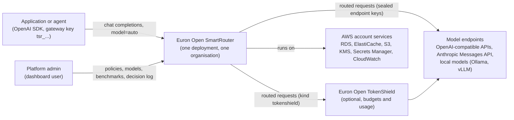
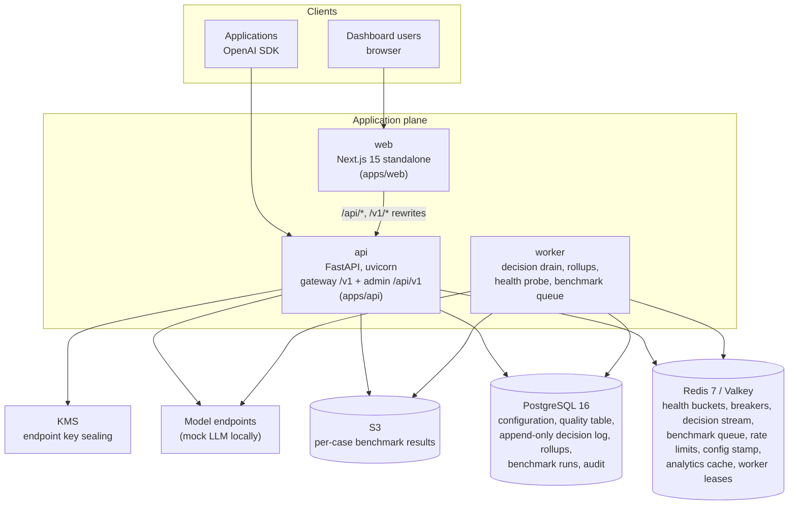
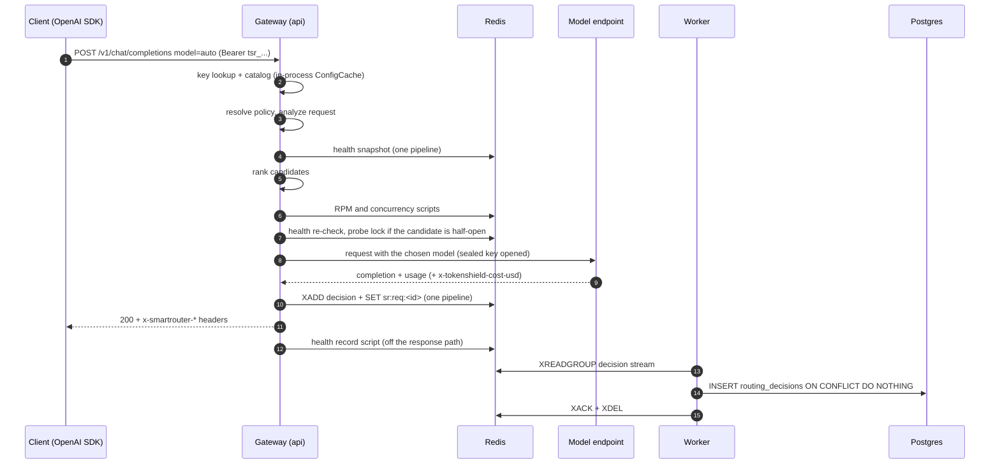
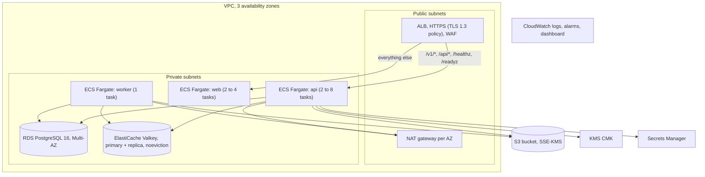

# High-Level Design

This document describes what Euron Open SmartRouter is made of, how the pieces talk to each
other, and how the system behaves under load and failure. The module-level detail is in the
[Low-Level Design](LLD.md), the tables in the [Data Model](data-model.md), the three
subsystems that carry most of the correctness argument in [Routing](routing.md),
[Health and fallback](health-and-fallback.md) and [Benchmarks](benchmarks.md), the cache
design in [Caching](caching.md), and the reasoning behind each major choice in the
[ADRs](adr/README.md).

- [Goals and non-goals](#goals-and-non-goals)
- [System context](#system-context)
- [Containers](#containers)
- [Component responsibilities](#component-responsibilities)
- [The request path](#the-request-path)
- [Main flows](#main-flows)
- [Caching layers](#caching-layers)
- [Deployment topology](#deployment-topology)
- [Scalability](#scalability)
- [Availability and failure modes](#availability-and-failure-modes)
- [Security summary](#security-summary)
- [Observability](#observability)
- [Key design decisions](#key-design-decisions)

## Goals and non-goals

SmartRouter is a self-hosted, OpenAI-compatible gateway that decides which model answers
each request. Applications send `model="auto"` (or `auto:<policy>`); SmartRouter analyses the
request, filters the configured models by hard constraints, ranks the rest by cost, live
latency and benchmark quality under a named policy, calls the best one, falls back in a
controlled way when it fails, and records why. The name is the contract: a router must
route, and it must never switch models silently.

**Goals**

| # | Goal | How it is met |
| - | ---- | ------------- |
| G1 | Any OpenAI SDK works by changing only `base_url`, `api_key` and `model` | OpenAI-compatible `/v1/chat/completions` (streaming and not) and `/v1/models`, which lists the `auto` routes and the models; provider adapters translate behind that surface |
| G2 | Each request goes to the cheapest or fastest model that is good enough for it | Deterministic request analysis (task, complexity, required capabilities), then a policy-weighted score over log-normalised cost, live latency and benchmark quality ([routing.md](routing.md)) |
| G3 | Hard constraints always hold | Context window, tools, vision, JSON output, allowed and excluded models, cost and latency ceilings and the quality floor are filters applied before scoring, each with a recorded reason |
| G4 | A failing model does not fail the application | Per-model health and circuit breakers in Redis shared by every replica; ordered fallback on retryable failures only, never after a stream has started ([health-and-fallback.md](health-and-fallback.md)) |
| G5 | Every decision can be read and challenged | An append-only decision log with the signals, every candidate's score and reason, the attempt chain, estimated, actual and baseline cost, and latency; response headers carry the summary |
| G6 | Quality numbers come from evidence, not vendor claims | A reproducible benchmark measures each model per task and difficulty band, feeds the quality table, and grades each policy against the always-best baseline with cross-fitting ([benchmarks.md](benchmarks.md)) |
| G7 | Works with Euron Open TokenShield without a second ledger | Actual cost read from `x-tokenshield-cost-usd`; a TokenShield `402 budget_exceeded` downgrades to a cheaper model when the policy allows ([ADR-0008](adr/0008-tokenshield-integration-without-a-second-ledger.md)) |
| G8 | Runnable on a laptop without an AWS account | Local AWS emulator (Floci) provisioned by the same Terraform modules as production, plus a deterministic mock LLM |

**Non-goals**

- **Multi-tenancy inside one deployment.** One install serves one organisation; teams,
  projects and keys live inside it ([ADR-0001](adr/0001-single-tenant-deployments.md)).
- **Budgets and spend enforcement.** SmartRouter keeps a routing decision log, not a budget
  ledger. Put TokenShield in front of the providers for budgets; SmartRouter reads its cost
  header and honours its refusals.
- **Response caching.** SmartRouter does not cache completions. TokenShield does, behind it.
- **Learned routing.** The analyzer is rule-based and the ranking is a weighted score. Learned
  routers and embedding-based task detection are on the roadmap ([PLAN.md](../PLAN.md)).
- **Storing prompts.** The decision log stores the analyzer's signals and the routing
  outcome, never the prompt or the completion.

## System context

C4 level 1: SmartRouter and the actors around it.



## Containers

C4 level 2: the deployable units and their stores. The API image runs the gateway, the admin
API, the worker and the one-off CLI; the web image runs the dashboard. The mock LLM runs only
locally and in tests.



## Component responsibilities

| Component | Code | Runs as | Owns | Never does |
| --------- | ---- | ------- | ---- | ---------- |
| Gateway | [`gateway`](../../apps/api/src/smartrouter/gateway) | Inside every api process | Key auth, the catalog read model, policy resolution, the routing pipeline, fallback, decision records, response headers | Write to Postgres on the success path while Redis is up (decisions go to the Redis stream) |
| Routing | [`routing`](../../apps/api/src/smartrouter/routing) | Library inside the api and worker | The analyzer, the ranking engine, policy CRUD, the quality table, the route simulator | Call a model |
| Health | [`health`](../../apps/api/src/smartrouter/health) | Library inside the api and worker | Per-model counters, latency ring and circuit breaker in Redis, one Lua script per outcome | Keep health in process memory |
| Admin API | the other domain packages under [`apps/api/src/smartrouter`](../../apps/api/src/smartrouter) | Inside every api process | Users, teams, projects, keys, endpoints, models, decisions and analytics, alerts, audit, benchmark runs | Serve gateway traffic |
| Worker | [`worker.py`](../../apps/api/src/smartrouter/worker.py) | Separate process, same image (`smartrouter worker`) | Drains the decision stream into Postgres, hourly rollups, endpoint health probes, queued benchmark runs | Take any HTTP traffic |
| Dashboard | [`apps/web`](../../apps/web) | Next.js standalone server | Every admin screen, including the route simulator; same-origin proxy of `/api` and `/v1` to the api | Hold a credential other than the httpOnly session cookie |
| Provider adapters | [`providers/adapters`](../../apps/api/src/smartrouter/providers/adapters) | Library inside the api and worker | Translate the OpenAI shape to a provider's native API and back; classify transport failures as not sent or uncertain; keep `x-tokenshield-*` and `x-request-id` response headers | Decide anything about routing |
| Mock LLM | [`apps/api/src/mockllm`](../../apps/api/src/mockllm) | Compose service locally, a thread in the integration tests | Deterministic OpenAI, Anthropic and TokenShield-style upstream with per-task skills, injectable faults and call counters | Run in production |

## The request path

The gateway runs one fixed sequence per chat completion. Everything up to the provider call
is answered from process memory or Redis.

```
  auth (gateway key, peppered HMAC, ConfigCache)
   -> resolve policy (auto:<name>, x-smartrouter-policy, project default, global default)
        concrete model name -> passthrough: no ranking, no fallback
   -> analyze (task, complexity 1 to 5, signals, tokens, capabilities; header overrides)
   -> health snapshot (one Redis pipeline for every model)
   -> rank (hard filters, quality floor, weighted score, deterministic tie breaks)
        nothing eligible -> 422 no_eligible_model
   -> admit (per-key RPM and concurrency in Redis)
   -> for each candidate, best first, up to max_attempts:
        health gate, re-checked at call time (half-open: one probe at a time;
          opened since ranking: skipped, unless the model is pinned)
        call the adapter
        classify the failure: retry (connect, timeout, 429, 5xx), downgrade (TokenShield 402),
        or return (other 4xx)
   -> record the decision (XADD to the decision stream, pipelined with the feedback marker
        SET sr:req:<request_id>; direct insert if Redis refuses)
   -> response with x-smartrouter-* headers
   ... worker drains the stream into Postgres (consumer group, ack after commit)
```

Postgres is on the request path only when the in-process catalog or a key record has to be
reloaded (at most every 5 s per process, or after an admin write) and when Redis rejects the
decision `XADD`. Off the response path, every failure recorded while a circuit is open attempts
one deduplicated alert insert, and `last_used_at` is written at most once a minute per key. The step-by-step
version is in [LLD.md](LLD.md#the-request-pipeline-step-by-step).

## Main flows

### A routed request



### A failure with fallback

The top candidate times out. The failure is retryable, the policy allows fallback and
`max_attempts` is not exhausted, so the gateway records a `timeout` attempt, updates that
model's health, and calls the next eligible candidate. The decision row carries both
attempts in `fallback_chain`, and the response carries `x-smartrouter-attempts: 2` and
`x-smartrouter-fallbacks` naming the failed model. If every attempt fails the client gets
`502 all_models_failed` with the attempts in `error.details`. With fallback disabled the first
failure is returned as is, except that a lone upstream 429 (fallback off, or a pinned model)
becomes `429 upstream_rate_limited` carrying the provider's `Retry-After`. See [health-and-fallback.md](health-and-fallback.md).

### A TokenShield budget refusal

The chosen model sits behind a TokenShield endpoint, which answers `402 budget_exceeded`.
With `budget_downgrade` on, the gateway skips every remaining candidate that is not strictly
cheaper than the refused one and tries the cheaper ones in rank order. With it off, the 402
is returned to the client unchanged. Integration tests
`test_budget_refusal_downgrades_to_a_cheaper_model` and
`test_budget_refusal_is_returned_when_downgrade_is_off` cover both.

### A benchmark run

An admin queues a run (`POST /api/v1/benchmarks/runs`). A worker pops it, calls every model
on all 160 cases (phase 1), writes the pass rates into `quality_scores`, then routes every
case through each policy with cross-fitted quality (phase 2), and stores the summary, the
per-cell results and a gzipped per-case file in object storage. If the queue push fails
(Redis down), the run is marked failed and the API answers `503 dependency_unavailable`. A
run left `running` by a worker that died is marked failed by the next worker's sweep once it
is older than `BENCHMARK_STALE_AFTER_S` (2 hours); the sweep runs once a minute. Result files
older than `BENCHMARK_RESULTS_DAYS` (365) answer 404 "expired". See
[benchmarks.md](benchmarks.md).

### Feedback

`POST /v1/feedback` accepts a request id only if SmartRouter routed it. It looks for the
decision row in Postgres, then for the marker `sr:req:<request_id>` (the project id, kept for
24 hours) that the gateway wrote in the same pipeline as the decision `XADD`, so feedback sent
before the worker drains the stream is accepted. An unknown id is `404`, another project's id
`400 not_your_request`. Feedback is rate limited per key (the key's RPM limit, else 600 per
minute).

## Caching layers

| Layer | What | Where | Key | TTL | Invalidation |
| ----- | ---- | ----- | --- | --- | ------------ |
| Gateway config | The catalog snapshot (endpoints, models, policies, projects, quality table, benchmark calibration, opened endpoint keys) and API key records | In-process dict per api process (`core/cache.py ConfigCache`) | `catalog`, `key:<prefix>` | 5 s | Every admin write that affects routing calls `invalidate()`, which clears the local copy and increments the Redis stamp `sr:cfg:version`; every process compares its stamp at most once a second and drops its copy when it moved |
| Opened endpoint keys | Decrypted provider credentials | In-process dict (`gateway/catalog.py _opened`) | endpoint id + SHA-256 of the sealed blob | Process lifetime | A new sealed value has a new digest, so a rotated key is opened on the first catalog load after the rotation, and the old plaintext for that endpoint is dropped from memory at the same moment |
| Derived quality | Band scores and per-task offsets (hierarchical shrinkage) | Computed once per `Catalog` instance | (model, band), (model, task) | Same as the catalog | Rebuilt with the catalog |
| Model health | Not cached: read on every routed request | Redis `sr:cb:*`, `sr:hl:*`, `sr:h:*` | per model | Buckets 360 s, latency ring of 200 | Each upstream outcome updates it atomically |
| Analytics | Overview, time series and breakdown responses | Redis `sr:an:<query>` over Postgres rollups | Query kind, range, breakdown dimension, project | 10 s | Expiry only (dashboards poll) |
| Rollups | Hourly aggregates by project, policy, task, final model and status | Postgres `decision_rollups_hourly` | Hour + dimensions | Recomputed every minute for the last few closed hours | Recompute is idempotent; the open hour is always read raw |
| Dashboard server state | API responses | TanStack Query in the browser | Per resource (`apps/web/src/lib/query-keys.ts`) | `staleTime` 10 s analytics, 30 s configuration, 5 s live views, 5 min static data | Invalidated by query key on mutation |
| HTTP | None | | | | The API sends no `Cache-Control` or `ETag`; responses over 2 KiB are gzipped |

There is no response cache: SmartRouter never answers a request without calling a model. The
full key design, the list of writes that invalidate, and what is tested are in
[caching.md](caching.md).

## Deployment topology

On AWS ([`infra/terraform/envs/aws-prod`](../../infra/terraform/envs/aws-prod)):



`aws-dev` is the same composition with two AZs, a single NAT gateway, a single-AZ database,
one cache node and smaller autoscaling ceilings. The module set (`network`, `database`, `cache`, `storage`, `kms`, `secrets`, `ecr`, `service`,
`observability`) is described in each module's README under
[`infra/terraform/modules`](../../infra/terraform/modules). Locally, `make up` runs the same
images in Docker Compose with Postgres, Redis and the mock LLM as containers and S3, KMS and
Secrets Manager on Floci, provisioned by `infra/terraform/envs/local-floci`. See
[deploy-aws.md](../guides/deploy-aws.md) and [quickstart-local.md](../guides/quickstart-local.md).

## Scalability

- **Stateless api processes.** Every piece of shared state (health buckets, breakers, probe
  locks, rate-limit windows, concurrency slots, the decision buffer, the benchmark queue, the
  config stamp) is in Redis, every durable fact in Postgres. Any number of api tasks can serve
  one deployment, and every replica sees the same open circuits.
- **Coordination is atomic in Redis.** A health outcome and the breaker transition it causes
  are one Lua script; the half-open probe is one `SET NX`; rate limits and concurrency slots
  are Lua scripts; worker jobs take a `SET NX EX` lease. No in-process lock decides anything
  that another replica could contradict ([ADR-0009](adr/0009-circuit-breakers-in-redis-lua.md)).
- **Routing is cheap and bounded.** Analysis is a fixed set of regular expressions; ranking is
  linear in the number of models; the health snapshot is one pipeline for all models. The
  time spent is recorded per decision (`routing_us`) and exported as
  `smartrouter_routing_seconds`.
- **Postgres writes are batched.** The worker writes up to 500 decisions per insert;
  duplicate request ids are ignored, so redelivery is harmless.
- **Dashboards read rollups.** Analytics cost scales with hours times dimensions, not with
  requests. The still-open hour, and any hour the worker has not rolled up yet, is read from
  raw decisions, so a lagging worker never leaves a gap.
- **Workers scale out safely.** Every worker drains the decision stream through one consumer
  group and listens on the benchmark queue; rollups and the health probe take a Redis lease, so
  exactly one instance runs each per interval.

## Availability and failure modes

| Failure | Behaviour |
| ------- | --------- |
| Redis unreachable | Routing continues: the health snapshot comes back empty, so every model is treated as closed and ranked on its latency prior; the half-open probe gate has no state to read and lets requests through; health outcomes are not recorded; per-key RPM and concurrency limits are skipped; decisions are inserted directly into Postgres; the config cache refreshes on its TTL only; analytics compute without caching; starting a benchmark marks the run failed and answers `503 dependency_unavailable`; feedback from a gateway key fails with 500 (its per-key limit is a Redis script with no fallback). `/readyz` reports 503. |
| Redis lost its data | Health and breakers restart from closed. Decisions still in the stream and not yet drained are lost (up to about a second with AOF `everysec`). |
| Postgres unreachable | Gateway requests keep working while each process's catalog copy is fresh (5 s TTL), and decisions wait in the Redis stream until the worker can commit them. Once the copy expires the catalog cannot be reloaded and requests fail with 500. Admin endpoints fail. `/readyz` reports 503. |
| Worker down | Gateway traffic is unaffected. The decision log and analytics lag (decisions wait in the stream, capped at about 1,000,000 entries), endpoint probes stop (circuits still reach half-open and recover through real traffic), queued benchmarks wait. Feedback still works for 24 hours per request through the `sr:req:` marker. A worker that dies mid-benchmark leaves its run `running` until another worker's sweep marks it failed after `BENCHMARK_STALE_AFTER_S`. |
| A model endpoint fails or slows down | The failure is recorded; after `BREAKER_FAILURE_THRESHOLD` consecutive failures, or an error rate above `BREAKER_ERROR_RATE` over the 5-minute window, the circuit opens and the model leaves every replica's candidate list until a half-open probe succeeds. Requests in flight fall back to the next candidate. |
| Every candidate fails | `502 all_models_failed` with the attempt chain; a single timed-out attempt is `504 upstream_timeout`; a single rate-limited attempt is `429 upstream_rate_limited` with the provider's `Retry-After`. The decision is logged with status `ERROR`. |
| A stream breaks after the first chunk | The client receives an SSE error event and `[DONE]`; no fallback (the client has already seen output); the decision is logged with `stream_interrupted`. |
| A configuration change | Visible on every api process within about a second (version stamp check interval), at worst within the 5 s TTL if Redis is down. |

## Security summary

Gateway keys are `tsr_<prefix>_<secret>`, stored as an HMAC-SHA256 of the secret under a
server-side pepper and looked up by prefix. Dashboard users sign in with argon2-hashed
passwords, get an HS256 session JWT in an httpOnly cookie, and cookie-authenticated mutations
require a custom CSRF header. Endpoint API keys are sealed with KMS (or AES-GCM locally) with an
encryption context bound to the endpoint row, and are never returned by the API. Benchmark
oracle annotations reach only endpoints marked simulated. The decision log stores signals,
not prompts. Production refuses to boot with demo secrets. Details in
[security.md](security.md); threats and residual risks, including outbound requests to
operator-supplied base URLs, in [threat-model.md](threat-model.md).

## Observability

- **Logs:** one JSON line per request with method, path, status, latency and request id;
  credentials redacted by key name. Every failure recorded while a model's circuit is open logs
  one `event=circuit_opened` line with the model and its `source` (`traffic` from the api,
  `probe` from the worker), through the shared `alerts/service.py circuit_opened()`, which also
  raises at most one alert per model per hour. The CloudWatch metric filter in the
  `observability` module counts the api's lines as `CircuitOpened`.
- **Metrics:** Prometheus `/metrics` on the api: `smartrouter_decisions_total` by policy, final
  model, task and status; `smartrouter_fallbacks_total` by policy;
  `smartrouter_savings_usd_total` by policy (actual tokens priced at the baseline minus actual
  cost, floored at zero); and the `smartrouter_routing_seconds` histogram (analysis and ranking,
  excluding the upstream call). See [operations.md](../guides/operations.md).
- **Probes:** `/healthz` (liveness, no dependencies) and `/readyz` (Postgres and Redis, 2 s
  timeout each).
- **Request ids:** every response carries `x-request-id` (an incoming alphanumeric value of up
  to 64 characters is honoured); gateway responses also carry `x-smartrouter-request-id`, the id
  the decision is stored under.
- **Tracing:** OpenTelemetry spans `router.chat` and `router.upstream` when `OTEL_ENABLED=true`.

## Key design decisions

| Decision | ADR |
| -------- | --- |
| One deployment serves one organisation | [ADR-0001](adr/0001-single-tenant-deployments.md) |
| Request analysis is deterministic and explainable | [ADR-0002](adr/0002-deterministic-explainable-request-analysis.md) |
| Money is integer nano-dollars | [ADR-0003](adr/0003-integer-nano-dollars.md) |
| Decisions go through a Redis stream, drained by the worker | [ADR-0004](adr/0004-decisions-through-a-redis-stream.md) |
| Local AWS emulation with Floci and the same Terraform | [ADR-0005](adr/0005-local-aws-emulation.md) |
| Cross-fitted benchmark, and expected quality over difficulty | [ADR-0006](adr/0006-cross-fitted-benchmark-and-expected-quality.md) |
| Python and FastAPI for the API, Next.js for the dashboard | [ADR-0007](adr/0007-python-fastapi-and-nextjs.md) |
| TokenShield integration without a second budget ledger | [ADR-0008](adr/0008-tokenshield-integration-without-a-second-ledger.md) |
| Circuit breakers and health in Redis Lua, shared across replicas | [ADR-0009](adr/0009-circuit-breakers-in-redis-lua.md) |
