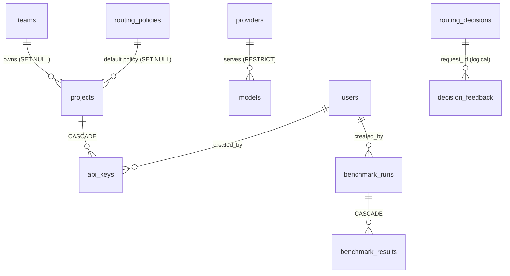

# Data model

PostgreSQL 16. The schema is owned by Alembic (`apps/api/src/smartrouter/migrations/versions/`:
`0001_initial_schema.py`, then the changes [below](#migrations)); SQLAlchemy models live in
each domain's `models.py`. Money columns are `BIGINT` integer nano-dollars (`*_nusd`, 1 USD =
1,000,000,000 nUSD, see [ADR-0003](adr/0003-integer-nano-dollars.md)); prices and cost ceilings
are `NUMERIC(14,6)` USD. Primary keys are UUIDs for configuration rows and `BIGINT` identities for
append-only and high-volume tables. Every timestamp is `timestamptz`.

Foreign keys exist only where shown. `routing_decisions`, `decision_feedback`, `quality_scores`
and `decision_rollups_hourly` refer to projects, keys, models and policies by id or name without
a constraint, so the log keeps its history when configuration changes.

## Configuration

| Table | Purpose | Key columns and constraints |
| --- | --- | --- |
| `users` | Dashboard accounts | `email` unique, `password_hash` (argon2), `role` owner/admin/viewer, `disabled`, `failed_logins`, `locked_until`, `last_login_at`, `session_version` (bumped to end sessions) |
| `teams` | Groups of projects | `slug` unique, `name`, `description` |
| `projects` | Workloads that send traffic | `slug` unique, `team_id` FK `teams` (`ON DELETE SET NULL`), `default_policy_id` FK `routing_policies` (`ON DELETE SET NULL`), `archived` |
| `api_keys` | Gateway credentials | `prefix` unique (12 hex chars, the lookup key), `secret_hash` (peppered HMAC-SHA256, 64 hex), `project_id` FK (`ON DELETE CASCADE`), `rpm_limit`, `concurrency_limit`, `expires_at`, `revoked_at`, `last_used_at` (written at most once a minute), `created_by` FK `users` |
| `providers` | Model endpoints | `name` unique, `kind` openai/anthropic/tokenshield, `base_url`, `sealed_key` (`BYTEA`, KMS or AES-GCM ciphertext, never returned), `key_hint` (last four characters), `timeout_s` `NUMERIC(6,1)`, `simulated` (may receive benchmark oracle metadata), `enabled` |
| `models` | Aliases the router chooses between | `alias` unique, `provider_id` FK (`ON DELETE RESTRICT`), `upstream_model`, `tier` fast/low-cost/advanced/local, `tokenizer`, `context_window`, `max_output_tokens`, `input_per_m` and `output_per_m` (`NUMERIC(14,6)` USD per 1M tokens), `supports_tools`, `supports_vision`, `supports_json`, `latency_prior_ms`, `enabled` |
| `routing_policies` | Named routing policies | `name` unique, `strategy`, `weights` (JSONB, null = strategy weights), `quality_floor`, `task_floors` (JSONB), `hard_floor_boost`, `max_latency_ms`, `max_cost_usd` `NUMERIC(14,6)`, `allowed_models` (JSONB, null = all), `excluded_models` (JSONB), `allow_fallback`, `max_attempts`, `budget_downgrade`, `on_no_eligible` best_quality/reject, `baseline_model`, `is_default`, `enabled` |
| `quality_scores` | The quality table the router ranks by | Unique `(model_alias, task, band)`; `score` (0 to 1), `samples` (cases behind it; 0 = manual), `source` benchmark/manual, `run_id`, `updated_at` |

Value sets (roles, kinds, tiers, strategies, `on_no_eligible`, task names) are validated by the
Pydantic schemas at the API boundary; the database stores them as strings without `CHECK`
constraints. At most one default policy is enforced by the database: the partial unique index
`uq_routing_policies_single_default` on `routing_policies (is_default) WHERE is_default`
(migration `0002`). The service clears the old default before it sets a new one, inside a
transaction-scoped advisory lock, so two concurrent "make default" requests run one after the
other instead of the loser failing on the index.

## The decision log (append-only)

| Table | Purpose | Key columns |
| --- | --- | --- |
| `routing_decisions` | One row per gateway request, whatever the outcome | `request_id` unique; attribution (`project_id`, `api_key_id`, `source` api/benchmark); the request (`requested_model`, `policy_name`, `strategy`); the analysis (`task`, `complexity`, `signals` JSONB, `input_tokens_est`); the decision (`selected_model`, `final_model`, `reason`, `candidates` JSONB with every model's eligibility, score, components, cost, latency, quality and reason, `floor_relaxed`); the attempts (`attempts`, `fallback_chain` JSONB); money (`estimated_cost_nusd`, `actual_cost_nusd`, `cost_source` computed/tokenshield/none, `baseline_model`, `baseline_cost_nusd`); usage (`input_tokens`, `output_tokens`); outcome (`status` SUCCESS/REJECTED/ERROR, `error_code`, `http_status`); timing (`latency_ms`, `upstream_ms`, `routing_us`); `stream`; `upstream_request_id` (TokenShield's or the provider's) |
| `decision_feedback` | Quality feedback from the application (`POST /v1/feedback`) | `request_id` (indexed, no FK), `score` -1 or 1, `comment` |
| `audit_log` | Every dashboard mutation | `at` (indexed), `actor_id`, `actor_email`, `action`, `target_type`, `target_id`, `details` JSONB, `ip` |

No table stores prompt or completion text. A decision keeps the analyzer's signals (rule names
and matched words from a fixed vocabulary) and, on failures, the upstream error message
(truncated to 120 characters per attempt and 500 for the reason).

**Append-only trigger.** The migration creates the function `smartrouter_refuse_change()`, which
raises `check_violation` ("`<table>` is append-only"), and a `BEFORE UPDATE OR DELETE ... FOR
EACH ROW` trigger `<table>_append_only` on `routing_decisions`, `decision_feedback` and
`audit_log`. Corrections are new rows. Inserts into `routing_decisions` use
`ON CONFLICT (request_id) DO NOTHING`, so a replayed batch from the decision stream never
duplicates a row.

## Benchmarks

| Table | Purpose | Key columns |
| --- | --- | --- |
| `benchmark_runs` | One row per run | `id` UUID, `status` queued/running/done/failed, `suite_version`, `models` and `policies` (JSONB lists), `summary` (JSONB: baseline, per-model and per-policy quality, cost, latency, savings and quality change, calibration, results file), `error`, `started_at`, `finished_at`, `created_by` FK `users` |
| `benchmark_results` | Aggregates per (target, task, band) | `run_id` FK (`ON DELETE CASCADE`, indexed), `target_type` model/policy, `target`, `task`, `band`, `cases`, `passed`, `score`, `cost_nusd`, `latency_ms_avg`, `model_mix` (JSONB, policies only) |

The per-case answers are not in the database; they are a gzipped JSON lines object in storage
(see [benchmarks.md](benchmarks.md#what-a-run-stores)).

## Derived and operational

| Table | Purpose |
| --- | --- |
| `decision_rollups_hourly` | Pre-aggregated decisions per hour. Primary key `(hour, project_id, policy_name, task, final_model, status)`; measures `requests`, `fallbacks`, `cost_nusd`, `baseline_cost_nusd` (successful requests only), `latency_ms_sum`, `input_tokens`, `output_tokens`. A missing project is stored as the nil UUID, a passthrough as policy `passthrough`, a failed request with no model as `''`. Maintained by the worker; benchmark decisions are excluded. Analytics read rollups for closed hours and raw decisions after the last rolled hour |
| `alerts` | Health alerts. `dedupe_key` unique, so a circuit that keeps failing creates one alert per model per hour; `kind`, `severity`, `message`, `acknowledged` |

## Indexes

Every filter the decision log and analytics expose has an index:

| Index | Columns | Serves |
| ----- | ------- | ------ |
| `ix_routing_decisions_created_at` | `created_at` | Time ranges, raw tail of analytics, rollup recompute |
| `ix_routing_decisions_project_id` | `project_id` | Project filter |
| `ix_decisions_project_created` | `(project_id, created_at)` | Project filter over a range |
| `ix_decisions_policy_created` | `(policy_name, created_at)` | Policy filter, policy request counts |
| `ix_decisions_model_created` | `(final_model, created_at)` | Model filter |
| `ix_decisions_task_created` | `(task, created_at)` | Task filter |
| `ix_decisions_fallbacks` | `created_at` where `attempts > 1` (partial) | "Fallbacks only" filter |
| `routing_decisions_request_id_key` | `request_id` unique | Detail lookup, idempotent inserts, feedback ownership check |
| `ix_decision_feedback_request_id` | `request_id` | Feedback joined onto decisions |
| `ix_audit_log_at` | `at` | Audit log listing |
| `ix_benchmark_results_run_id` | `run_id` | Run detail |
| `uq_routing_policies_single_default` | `is_default` unique where `is_default` (partial) | At most one default policy |

The decision log paginates by primary key (keyset: `id < cursor`, newest first), so page cost is
constant at any depth. The `status` and `source` filters have no index of their own; they are
applied on top of the keyset scan.

## Migrations

| Revision | Change |
| -------- | ------ |
| `0001` | The initial schema: every table above, the indexes and the append-only triggers |
| `0002` | Adds the partial unique index `uq_routing_policies_single_default`, and drops `alerts.budget_id`, an unused column inherited from TokenShield (alerts are raised for model health, never for budgets). The downgrade restores both |

Run them with `smartrouter migrate` (`make aws-migrate` on AWS). An applied revision is never
edited; each change is a new one.

## Redis

Redis holds no durable record, only state that is rebuilt or drained: model health and
breakers, the decision stream, the feedback markers `sr:req:<request_id>` (24 hours), rate-limit
windows and concurrency slots, the config stamp `sr:cfg:version`, the benchmark queue, the
analytics cache and worker leases. Every key starts with `sr:`, so SmartRouter can share a Redis
database with TokenShield (`ts:`). The full key list, with types and TTLs, is in
[LLD.md](LLD.md#redis-key-reference).

## Money

All amounts inside the system are integer nano-dollars. `core/money.py` converts USD prices to
nano-dollars with `ROUND_CEILING`, so an estimate can only overstate a cost. A
`x-tokenshield-cost-usd` header is parsed as a decimal and converted the same way. The API
converts to USD floats only at the edge (analytics, decision detail, headers with nine decimal
places).
