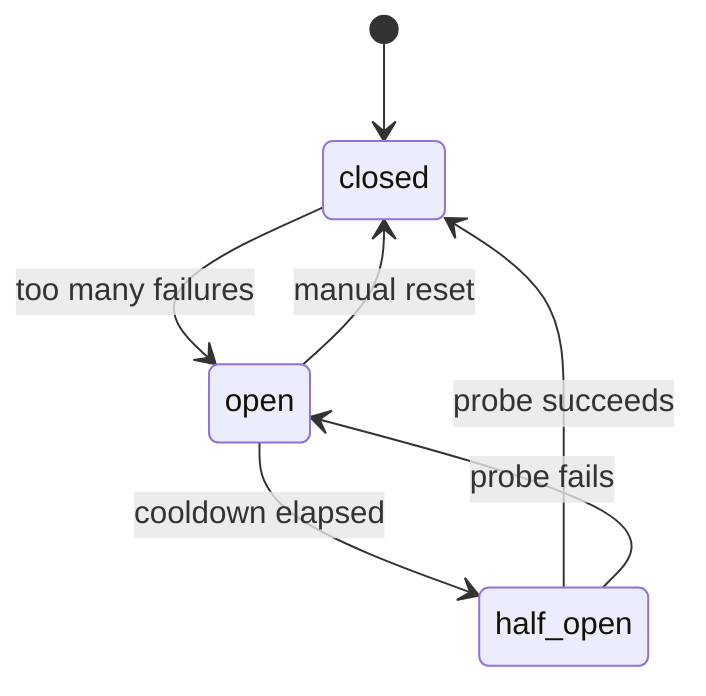

# Health and fallback

A router that sends traffic to a failing model is worse than no router. This document covers
how SmartRouter measures each model's health, how circuit breakers take a failing model out of
rotation on every replica at once and bring it back, which failures trigger a fallback to the
next candidate, and what is recorded and alerted. The code is `health/tracker.py`, the candidate
loop in `gateway/service.py`, and the probe in `worker.py`. The decision to keep all of this in
Redis Lua is [ADR-0009](adr/0009-circuit-breakers-in-redis-lua.md).

- [What is measured](#what-is-measured)
- [The circuit breaker](#the-circuit-breaker)
- [The worker probe](#the-worker-probe)
- [Fallback](#fallback)
- [Alerts and the circuit_opened event](#alerts-and-the-circuit_opened-event)
- [Failure modes](#failure-modes)
- [What is tested](#what-is-tested)

## What is measured

Every upstream outcome is recorded with one atomic Lua script (`HealthTracker.record`) that
updates three keys per model:

| Key | Contents | Lifetime |
| --- | -------- | -------- |
| `sr:h:<alias>:<minute>` | Hash of outcome counts for one wall-clock minute: `ok`, `error`, `timeout`, `throttled` | 360 s, so the five most recent buckets always exist |
| `sr:hl:<alias>` | List of the most recent successful latencies in milliseconds | Trimmed to 200 entries |
| `sr:cb:<alias>` | Breaker hash: `state`, `consecutive` failures, `opened_at`, `changed_at` | No expiry |

What counts as which outcome:

| Upstream result | Recorded as |
| --------------- | ----------- |
| Success (or a stream that finished, or a client that disconnected mid-stream) | `ok`, with a latency sample for non-probe calls |
| Connect error, 5xx, a stream that broke after the first chunk | `error` |
| Read or write timeout, dropped connection, empty stream | `timeout` |
| `429` | `throttled` |
| TokenShield `402 budget_exceeded` | `ok`: the model is healthy, the budget is not |
| Any other `4xx` | nothing: it says something about the request, not the model |

Outcomes are recorded off the response path (a background task), so a slow Redis never delays
the answer.

`HealthTracker.snapshot` reads all of this for every model in one non-transactional pipeline
and computes, per model: breaker state, p50 and p95 latency over the ring, the error rate over the
last five buckets (everything that is not `ok`, divided by the total), and the sample count. The
ranking engine uses the live p50 as expected latency once a model has at least 5 samples, and the
model's `latency_prior_ms` before that. `GET /api/v1/health/models` shows the same snapshot plus
the window counts in the dashboard.

## The circuit breaker

"Too many failures" is `BREAKER_FAILURE_THRESHOLD` consecutive failures, or an error rate above
`BREAKER_ERROR_RATE` with at least `BREAKER_MIN_SAMPLES` outcomes in the window. Half-open is
computed on read once the cooldown has elapsed; a failed probe restarts the cooldown.

| State | Router behaviour |
| ----- | ---------------- |
| `closed` | Normal |
| `open` | Filtered out of every ranking with the reason "circuit open: recent failures" |
| `half_open` | Eligible again; the first request to reach it takes the probe lock and calls it, every other request skips it and moves to its next candidate |

Thresholds come from configuration (`core/config.py`), with these defaults:

| Setting | Default | Meaning |
| ------- | ------- | ------- |
| `BREAKER_FAILURE_THRESHOLD` | 5 | Consecutive failures that open the circuit |
| `BREAKER_ERROR_RATE` | 0.5 | Error rate over the 5-minute window that opens it... |
| `BREAKER_MIN_SAMPLES` | 10 | ...once the window holds at least this many outcomes |
| `BREAKER_COOLDOWN_S` | 30 | Time an open circuit waits before it reports `half_open`; also the probe lock's TTL |

How the record script moves the breaker:

- An `ok` outcome resets `consecutive` to 0 and, if the stored state is not `closed`, closes the
  circuit. Any `ok` does this, including a slow request that was already in flight when the
  circuit opened.
- A failure increments `consecutive`. If the stored state is `open` (which includes a circuit
  reported as half-open, because half-open is derived on read), the circuit is re-opened with a
  fresh `opened_at`, restarting the cooldown. Otherwise the script sums the five most recent
  buckets and opens the circuit when `consecutive >= threshold`, or when the window has at
  least `min_samples` outcomes and more than `error_rate` of them failed.

**Half-open is computed, not stored.** `snapshot` reports a stored `open` breaker whose
`opened_at` is at least `cooldown_s` ago as `half_open`. This avoids a timer: whichever replica
reads the breaker first after the cooldown sees the same state as every other replica.

**The health gate re-checks at call time.** Ranking works from one snapshot taken before the
first attempt. By the time a later candidate is reached, an earlier attempt may have failed, or
another replica's traffic or the worker's probe may have opened a circuit. So before every
call, `GatewayService._health_gate` reads that one model's health again:

| State at call time | Routed request | Pinned model |
| ------------------ | -------------- | ------------ |
| `closed` | Called | Called |
| `half_open` | Called only by the request that wins the probe lock; others skip it ("half-open: probe already in flight") | Same |
| `open` | Skipped ("circuit opened after ranking"), the next candidate is tried | Called: the caller chose it |

**Single probe.** A half-open model is called only by the request that wins
`SET sr:cbp:<alias> 1 NX EX <cooldown_s>`. The lock is not deleted after the probe; it expires
with the cooldown, and once the probe's outcome closes or re-opens the circuit the model is no
longer half-open anyway.

**Manual reset.** `POST /api/v1/health/models/{alias}/reset` (admin) deletes the breaker hash and
the probe lock, closing the circuit at once, and writes an audit row.

## The worker probe

Real traffic is not the only signal: a model nobody is calling can recover unnoticed, and an
endpoint can go down between requests. The worker's `health_probe` job runs every
`HEALTH_PROBE_INTERVAL_S` (15 s by default) on one worker at a time (Redis lease), and for each
enabled endpoint:

1. sends `GET <base_url>/models` (Anthropic: `/v1/models` with `anthropic-version`), with the
   opened endpoint key, and a 5 s timeout;
2. treats a transport error, a 5xx, a 401 or a 403 as a failure, and anything else as success;
3. on failure, records `error` (without a latency sample) against **every model the endpoint
   serves**, so an unreachable endpoint opens its models' circuits even without traffic;
4. on success, records `ok` only for models whose circuit is half-open, which closes them.

A successful probe is not recorded for a closed circuit, so it does not reset the
consecutive-failure count; successful real traffic does. When a failed probe leaves a circuit
open, the worker calls the same `circuit_opened()` as the gateway, with `source="probe"`, so an
endpoint that goes down while nobody calls it still raises an alert (see
[below](#alerts-and-the-circuit_opened-event)).

## Fallback

The gateway tries the eligible candidates in rank order, at most `max_attempts` of them when the
policy allows fallback and only the first when it does not. The rules, from the module docstring
of `gateway/service.py` and enforced by `_classify` and the candidate loop:

| Failure | Retried on the next candidate? |
| ------- | ------------------------------ |
| Connect error, connect or pool timeout (the request never left) | Yes |
| Read or write timeout, dropped connection (sent, no answer) | Yes |
| `429` | Yes |
| `5xx` | Yes |
| TokenShield `402 budget_exceeded` (code `budget_exceeded`, or any `402` carrying `x-tokenshield-request-id`) | Only on candidates whose estimated cost is strictly below the refused model's, and only when the policy sets `budget_downgrade`; otherwise returned to the client |
| Any other `4xx` | No: the request itself is wrong, and the upstream error is returned |

Further rules:

- **Fallback is never silent.** Every attempt, including skipped candidates and why they were
  skipped, is appended to the decision's `fallback_chain` (`model`, `outcome`, `ms`, `status`,
  `detail`). The response carries `x-smartrouter-attempts` and, when any attempt failed,
  `x-smartrouter-fallbacks`.
- **Streams fall back only before the first chunk.** The gateway waits for the first chunk from
  a candidate before returning the streaming response. A failure (or an empty stream) before
  that point is retried like any other; after it, the client has seen output from one model, so
  a failure becomes an SSE error event and `[DONE]`, and the decision is logged with
  `stream_interrupted`.
- **Pinned models have no fallback.** A concrete model name in `model` runs under the internal
  `passthrough` policy: one candidate, `allow_fallback = false`, `max_attempts = 1`. Its failure is
  returned as is. A pinned model is not ranked, so it is called even when its circuit is open;
  the half-open probe gate still applies.
- **With fallback disabled the error is returned**, never switched: a retryable failure ends the
  loop and the client receives `502 all_models_failed` (or `504 upstream_timeout` for a single
  timed-out attempt), with the attempt in `error.details`.
- **A lone 429 stays a 429.** When exactly one model was called and its provider answered
  `429` (a pinned model, fallback off, or no other candidate left), the client receives
  `429 upstream_rate_limited` with the provider's `Retry-After` (kept from the upstream
  response by `providers/adapters/http.py`; `1` when the provider sent none), so its normal
  back-off applies. More than one failed attempt is still `502 all_models_failed`.
- **A timeout is retried.** The provider may have processed a request that timed out, so a
  fallback after a timeout can be billed twice (once by the model that timed out, once by the
  fallback). This is the cost of availability; policies that cannot accept it should set
  `allow_fallback = false` or `max_attempts = 1`.

## Alerts and the circuit_opened event

When a recorded outcome is a failure and the record script returns `open` (the failure opened
the circuit, or hit an already open one), the caller runs `alerts/service.py circuit_opened()`.
Two callers share it: `GatewayService._health` for request traffic (`source="traffic"`) and the
worker's `probe` (`source="probe"`). It:

1. logs a structured warning with `event=circuit_opened`, `model=<alias>` and
   `source=traffic|probe`. One line per such failure. The `observability` Terraform module's
   metric filter (`{ $.event = "circuit_opened" }`) on the api log group turns the api's lines
   into `SmartRouter/<name_prefix>/CircuitOpened`, and `circuit_open_threshold` sets an alarm on
   it. The worker's lines go to the worker log group, which the filter does not read;
2. inserts an `alerts` row of kind `health`, severity `critical`, with
   `dedupe_key = circuit:<alias>:<YYYYMMDDHH>` (UTC) and `ON CONFLICT DO NOTHING`, so a model
   produces at most **one alert per hour** however many requests fail. Alerts are listed and
   acknowledged in the dashboard (`/api/v1/alerts`).

## Failure modes

| Situation | Behaviour |
| --------- | --------- |
| Redis unreachable | `snapshot` returns nothing, so every model is ranked as closed on its latency prior; the probe gate has no state and lets requests through; `record` returns `unknown` and stores nothing. Routing keeps working without health awareness |
| Redis lost its data | Breakers and windows restart from closed and empty |
| Worker down | No probes. Open circuits still become half-open after the cooldown and recover through a real request |
| Every replica sees failures at once | The script is atomic per call, so concurrent failures are applied one after another: each increments `consecutive` exactly once, and failures that arrive after the circuit opened restart its cooldown |
| A model fails only for some requests | The error-rate rule catches it once the window has enough samples, even without five consecutive failures |

## What is tested

| Behaviour | Test |
| --------- | ---- |
| An open circuit is never chosen | `test_open_circuit_is_never_chosen` (integration), `test_open_circuit_is_skipped` (engine unit) |
| Recovery through a half-open probe | `test_breaker_recovers_through_a_half_open_probe` |
| Manual reset | `test_manual_reset_closes_a_circuit` |
| Failure falls back and the chain is recorded | `test_failure_falls_back_and_the_chain_is_recorded` |
| 429 and timeouts are retryable | `test_throttling_and_timeouts_are_retryable` |
| Fallback disabled returns the error | `test_with_fallback_disabled_the_error_is_returned` |
| TokenShield 402 downgrade on and off | `test_budget_refusal_downgrades_to_a_cheaper_model`, `test_budget_refusal_is_returned_when_downgrade_is_off` |
| One alert per opening, acknowledgeable | `test_circuit_open_raises_one_alert_that_can_be_acknowledged` |
| A circuit opened by the worker's probe raises an alert | `test_a_circuit_opened_by_probes_raises_an_alert` |
| Only one request probes a half-open circuit | `test_only_one_request_probes_a_half_open_circuit` |
| A stream falls back before its first chunk | `test_a_stream_falls_back_before_the_first_chunk` |
| A pinned model rate limited upstream returns 429 | `test_a_pinned_model_rate_limited_upstream_returns_429` |
| Probe failures count against the endpoint's models | `test_probe_counts_an_unreachable_endpoint_against_its_models` |
| A probe closes a half-open circuit | `test_probe_closes_a_half_open_circuit` |

Not yet covered by a dedicated test: a candidate skipped because its circuit opened between
ranking and the call.
